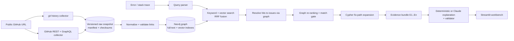

# From Stack Trace to Fix Path: GitHub Troubleshooting Graphs with Neo4j

Paste an error, a stack trace or a symptom. The app finds the historical GitHub report it matches, then **follows
evidence through a Neo4j graph** — issue → fixing PR → changed code → merge commit → release containing the fix.
It explains only what that evidence supports, and it says so when the evidence is too weak.

Built for NODES 2026 (November 12, 2026), validated against [psf/requests](https://github.com/psf/requests).



## What it does

| Capability | Where |
|---|---|
| Ingest any public repo from its URL (no hard-coded issues, no SWE-bench pairings) | `ingestion/fetch_repository.py` |
| Git evidence: PR merge/squash commits, patches, tags + **release ancestry**, release notes, docs, code | `ingestion/git_history.py` |
| API evidence: issue/PR text, comments, timeline events, **GraphQL closing references**, PR files | `ingestion/github_client.py` |
| Reproducible snapshots with manifest, collection errors and SHA-256 checksums | `ingestion/snapshot.py` |
| Provenance on every evidence edge: `basis`, `verification_status`, `source_url`, `retrieved_at`, `extractor_version` | `ingestion/normalize.py` |
| Validation gates (endpoints, schema, repo identity, no REFERENCES→CLOSES promotion) | `ingestion/validate_links.py` |
| Keyword, vector, hybrid (RRF) and hybrid + graph re-ranking, switchable | `retrieval/` |
| Explicit no-match state, with negative controls in the benchmark | `retrieval/rerank.py`, `evaluation/` |
| Deterministic explanations, or Claude explanations checked claim-by-claim against the evidence | `explanation/` |
| Streamlit workbench: Summary · Fix Graph · Code Diff · Evidence · Cypher | `app.py`, `ui/` |

### Evidence levels (never silently promoted)

| Edge | Level | Comes from |
|---|---|---|
| `(:PullRequest)-[:CLOSES]->(:Issue)` | **verified** | GraphQL `closingIssuesReferences`, or a timeline `closed` event whose commit belongs to the PR |
| `(:PullRequest)-[:REFERENCES]->(:Issue)` | **referenced** | `#N`/URL/closing keyword in the PR text, a commit message, or a timeline cross-reference |
| `(:PullRequest)-[:POSSIBLY_ADDRESSES]->(:Issue)` | **inferred** | a number in the branch name (`mondeja/5367`), or a stack-frame function the PR changed |
| `(:Release)-[:CONTAINS_COMMIT {earliest_containing}]->(:Commit)` | verified | `git rev-list <tag>` ancestry; *earliest* is claimed only when the release history is complete |

## Quick start

```bash
cp .env.example .env              # set NEO4J_PASSWORD; GITHUB_TOKEN for API collection
python -m venv .venv && . .venv/bin/activate
pip install -r requirements.txt
make neo4j                        # docker compose up -d neo4j
make model                        # downloads BAAI/bge-small-en-v1.5 once (~130 MB)
make data                         # normalize the committed snapshot + load Neo4j with embeddings
make app                          # http://localhost:8501
```

Neo4j Browser is at http://localhost:7474 if you want to run the queries from `graph/queries.py` by hand.
`docker compose up` also runs the app in a container (port 8501).

### The committed snapshot

`data/snapshots/psf-requests-v2.32.3/raw/` is a **git-only** snapshot of Requests frozen at `v2.32.3`
(PRs merged 2017-01-01 → 2024-06-30: 368 PRs, 846 commits, 161 release tags, 155 release-note sections,
docs and source). From git alone the graph already contains, for the headline case:

```
(:Issue {number: 5367})<-[:REFERENCES {basis: 'commit_message_text_mention'}]-(:PullRequest {number: 5414})
(:PullRequest {number: 5414})-[:HAS_PATCH]->(:PatchHunk)-[:IN_FILE]->(:File {path: 'requests/models.py'})
(:PullRequest {number: 5414})-[:MERGED_AS]->(:Commit {short_sha: 'd0965999'})
    <-[:CONTAINS_COMMIT {earliest_containing: true}]-(:Release {tag: 'v2.27.0'})
```

Git cannot see issue titles, bodies or GitHub's own link records, so in this snapshot issue nodes are
*stubs* and links are **referenced** at best. The UI says so. To get issue text and **verified** links,
collect with the API (below).

### Collecting with the GitHub API (do this before the conference)

```bash
export GITHUB_TOKEN=...           # fine-grained token, public repositories read-only
make collect SINCE=2019-01-01     # git + API; resumable (HTTP responses are cached in data/http_cache)
make data
make evaluate
```

With a token the API budget is 5,000 requests/hour. Each issue costs ~2–3 requests (comments + timeline),
each PR ~2 (files + GraphQL), so a 2019–2024 window takes roughly an hour; an interrupted run resumes from the
cache. `max-issues` / `max-prs` bound the run, and any limit that was hit is recorded as a warning in the
manifest and shown in the UI.

## Evaluation

`python -m evaluation.evaluate_retrieval` runs `evaluation/benchmark_cases.json`: 17 positive cases built
from real Requests fixes (expected issue/PR/file/release taken from git, independently of this system)
plus 6 negative controls from other ecosystems. Current results on the committed **git-only** snapshot with
the **offline hashing embedder**:

| Mode | Hit@1 | Hit@5 | MRR@5 | Correct fix path | No-match rejection | Avg latency |
|---|---|---|---|---|---|---|
| Keyword | 0.35 | 1.00 | 0.60 | 0.35 | 100% | ~220 ms |
| Vector | 0.53 | 0.94 | 0.66 | 0.53 | 100% | ~200 ms |
| Hybrid (RRF) | 0.59 | 1.00 | 0.76 | 0.59 | 100% | ~250 ms |
| **Hybrid + graph** | **0.76** | 1.00 | **0.88** | **0.71** | 100% | ~255 ms |

Read these with their caveats (details in `docs/EVALUATION.md`): 17 cases is small; the queries were
authored for the benchmark rather than copied from real reports; the hashing embedder is lexical, so
"vector" here is not semantic search; and issue text was not available. **Re-run after `make collect` with
`EMBEDDER=fastembed`; those are the numbers to present.**

## Tests

```bash
make test        # unit tests + mocked GitHub API + Neo4j integration + Streamlit AppTest
```

Integration and UI tests skip automatically when Neo4j with a loaded snapshot is not reachable.

## Project layout

```
app.py                     Streamlit entry point (3 views)
config.py                  settings from environment / .env
ingestion/                 GitHub connector, git collector, snapshot, extraction, normalization, validation
graph/                     schema.cypher, Neo4j loader, parameterized Cypher (queries.py)
retrieval/                 query parsing, embeddings, hybrid search, re-ranking, fix-path expansion, pipeline
explanation/               evidence bundle, deterministic + Claude answers, answer validator
ui/                        repository, investigation, graph, diff and evaluation views
evaluation/                benchmark cases, retrieval + evidence evaluation, results/
data/snapshots/            frozen raw snapshots (graph/ and embeddings/ are rebuilt by `make data`)
docs/                      architecture notes, demo script, evaluation notes
tests/                     pytest suite
```

## Not built (by design)

Autonomous code changes or PR creation, guaranteed root-cause diagnosis, continuous multi-repo monitoring,
runtime/dependency analysis, multi-user hosting.
